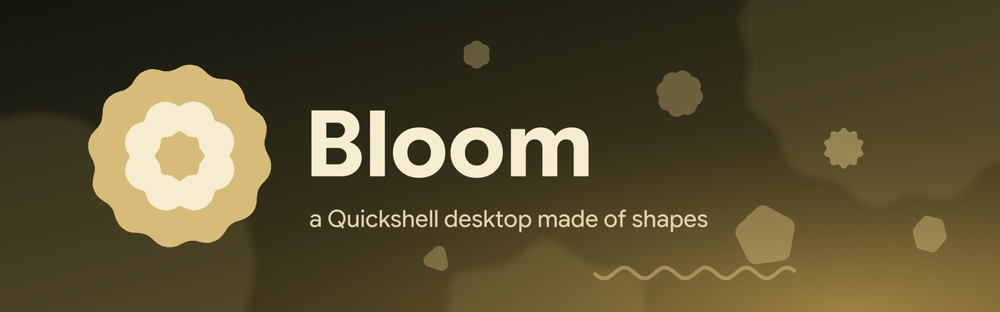
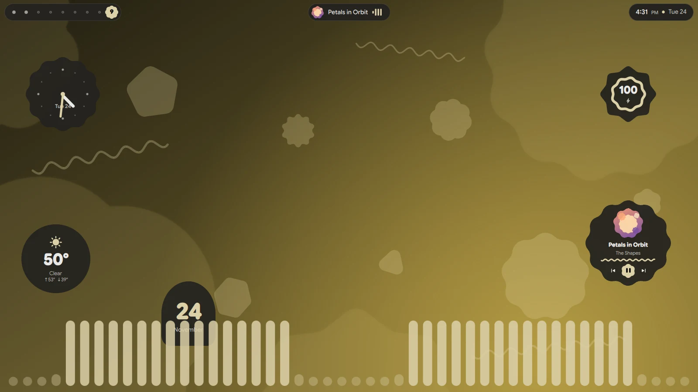
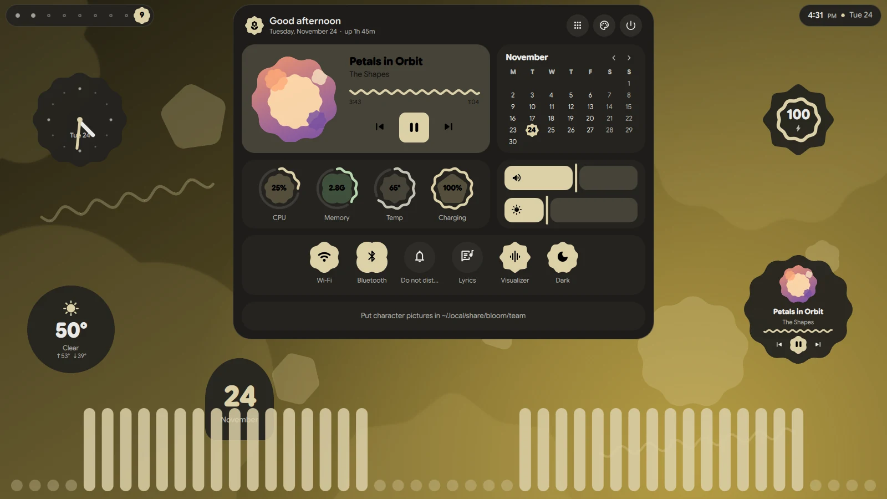
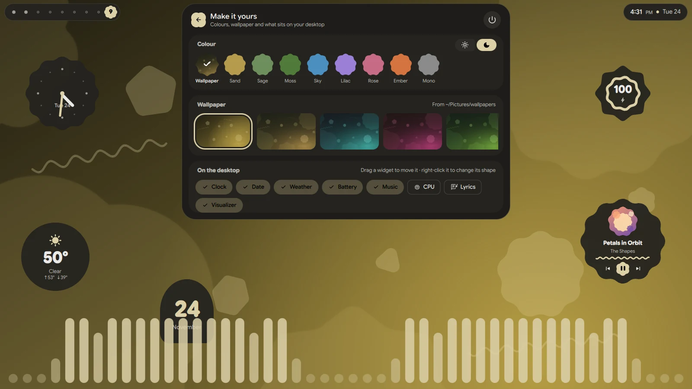
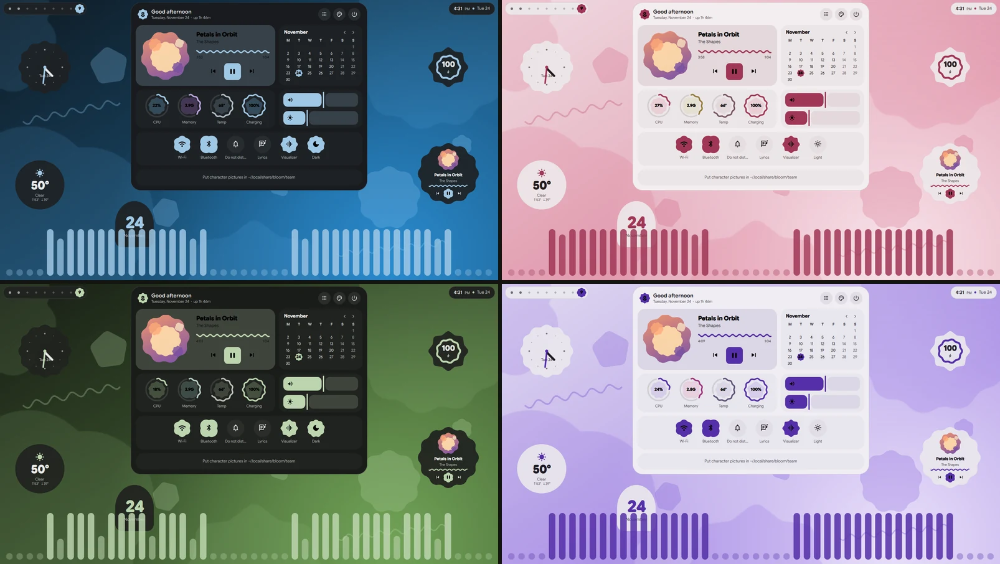
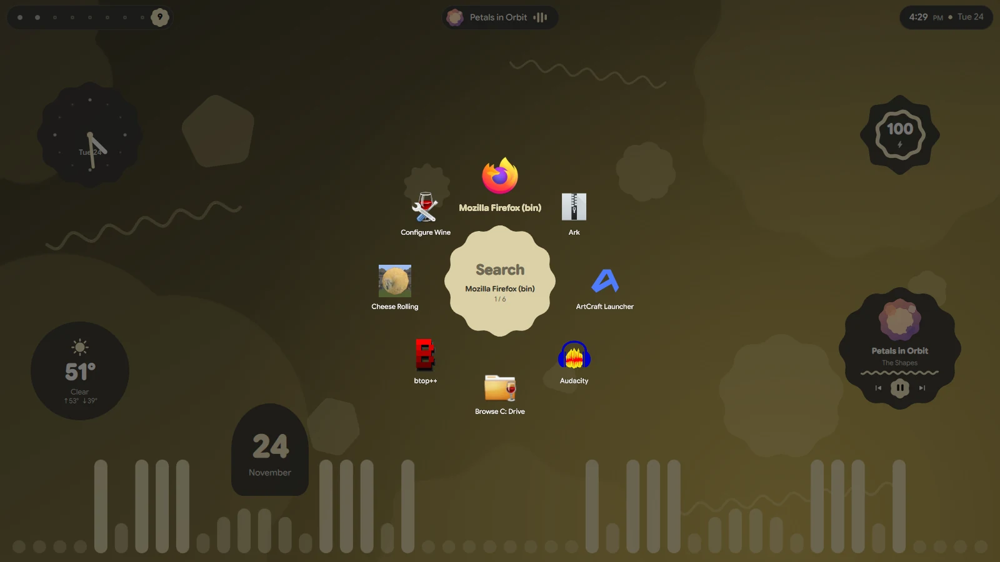
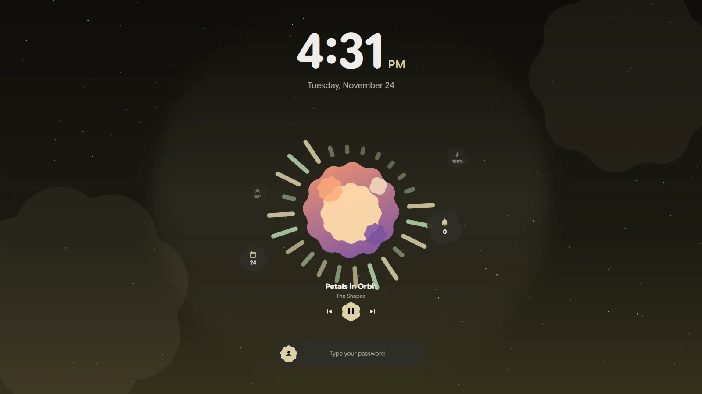

<p align="center">
  
</p>

<p align="center">
  A small, soft <a href="https://quickshell.org">Quickshell</a> desktop for Hyprland, built out of Material&nbsp;3&nbsp;Expressive shapes.<br>
  One colour paints everything. Your music lives on the wallpaper. It does a few things, and it does them nicely.
</p>

<p align="center">
  
</p>

---

## What it feels like

Bloom isn't trying to be a control panel for your whole computer. It's a calm desktop with personality:
cookies, clovers, sunbursts and squiggles instead of boxes, things that morph instead of popping, and just
enough customisation to make it yours without a settings maze.

### The island

A floating bar: your workspaces on the left, the time on the right, and in the middle a **dynamic island**
that shows what's going on. The song playing, a volume or brightness change, a notification dropping in.
Click it and it opens into everything else.

<p align="center"></p>

- **Music** with the cover cut into a slowly turning cookie and a wavy progress line you can click to seek
- **Calendar**, with today sitting in a little sun
- **Your computer at a glance**: CPU, memory, temperature and battery, each a shape with a squiggly ring
- **Volume and brightness** sliders, and round toggles that bloom into shapes when they're on
- **Your own characters** along the bottom, if you like: drop pictures in `~/.local/share/bloom/team`
  and they'll stand there bobbing gently

### Music on the wallpaper

While something plays, the song's **lyrics** float on the wallpaper, words lighting up as they're sung
(timed lyrics from [lrclib](https://lrclib.net)), and a **visualizer** breathes along the bottom of the
screen, tuned so a quiet song stays quiet. Both are on from the start and one click to turn off.

### Make it yours, in one place

<p align="center"></p>

Pick a colour, or let Bloom take one from your wallpaper. Light or dark. Choose a wallpaper from
`~/Pictures/wallpapers`, or keep Bloom's own, which repaints itself in whatever colour you choose.
Turn widgets on and off. That's it, and that's on purpose.

<p align="center"></p>

### Widgets that are just shapes

A clock in a twelve-sided cookie, the date in an arch, the weather in a circle, the battery in a sunburst,
your music, your CPU. **Drag them anywhere, any time.** **Right-click one** to turn it into a different
shape. No edit mode, no grid.

### An app ring

<p align="center"></p>

Press <kbd>Super</kbd>+<kbd>R</kbd> and a big shape appears in the middle of the screen. Type into it and
your apps gather in a ring around it, spinning round as the list changes and turning to put your pick on
top. <kbd>Enter</kbd> to open. The apps you use most come first.

### A lock screen with a little orbit

<p align="center"></p>

A night sky in your colour, the time, and in the middle a bloom: what's playing, ringed with petals that
move to the music. The weather, battery, date and notifications orbit around it, passing behind and in
front. Just start typing; every letter of your password is a different little shape.

---

## Install

Bloom is a Quickshell config. You'll need:

- **Hyprland** and **Quickshell 0.3+** (Qt 6.9 or newer)
- **Fonts:** [Google Sans Flex](https://fonts.google.com/specimen/Google+Sans+Flex) and
  [Material Symbols Rounded](https://fonts.google.com/icons)
- **cava** for the visualizer, **brightnessctl** for brightness, **NetworkManager** (`nmcli`) for Wi-Fi
- **Python 3 with Pillow** (picks colours from wallpapers, tidies up character pictures)
- **PipeWire**, **UPower** and **BlueZ**, which you most likely have already

```sh
git clone https://github.com/BugzySleeps/bloom ~/.config/quickshell/bloom
qs -c bloom
```

To start it with Hyprland, add `exec-once = qs -c bloom` (or `hl.exec_cmd("qs -c bloom")` with a Lua config).
Bloom has its own notifications, so stop any other notification daemon first.

### Keys

Bloom listens over Quickshell's IPC, so bind whatever you like:

| Does | Command |
|---|---|
| Open the island | `qs -c bloom ipc call island toggle` |
| App ring | `qs -c bloom ipc call launcher toggle` |
| Colours & wallpaper | `qs -c bloom ipc call wall toggle` |
| Lock | `qs -c bloom ipc call lock lock` |
| Have a look at the lock screen without locking | `qs -c bloom ipc call lock preview` |
| Always show one media player first | `qs -c bloom ipc call media prefer <name>` |

Settings live in `~/.local/state/bloom/settings.json`, though you shouldn't need to open it.

---

## Made with

Inspired by [Nebula](https://github.com/LilaccFlowerr/Nebula)'s shapes, ring launcher and lock screen, and by
[pocket-dots](https://github.com/diegoMalagrida/pocket-dots)' notch and little team strip. Bloom is written
from scratch: its shapes come from its own small rounded-polygon engine (`components/Shapes.js`), so there's
nothing to compile and nothing to install as root. The wallpaper, logo and banner are made by the scripts in
`tools/`.

Weather from [Open-Meteo](https://open-meteo.com), lyrics from [lrclib](https://lrclib.net).

## Licence

You're welcome to install Bloom, change your own copy, and show it off. Please don't copy its code or
artwork into other projects or republish it. See [LICENSE](LICENSE) for the details.
